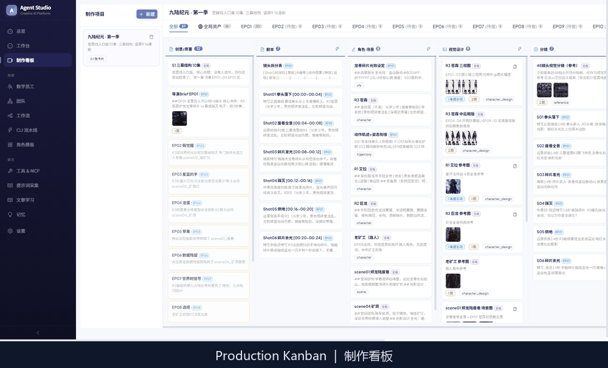
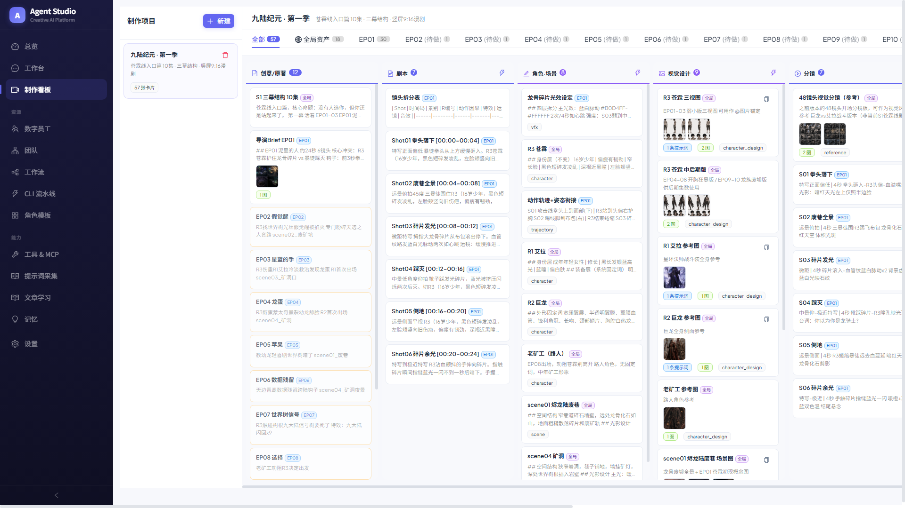
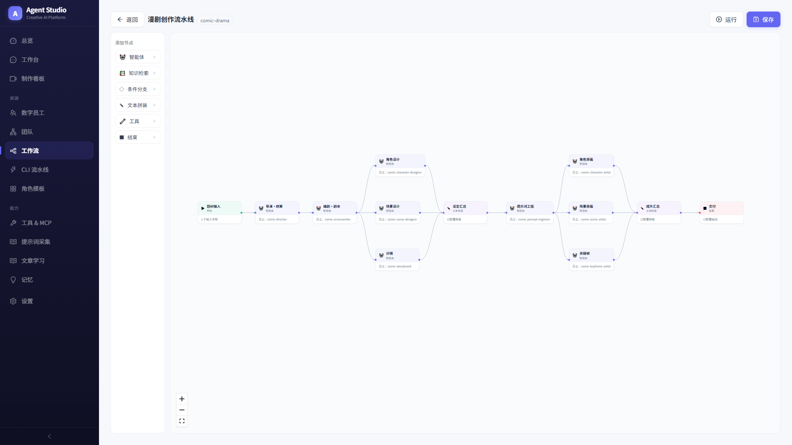
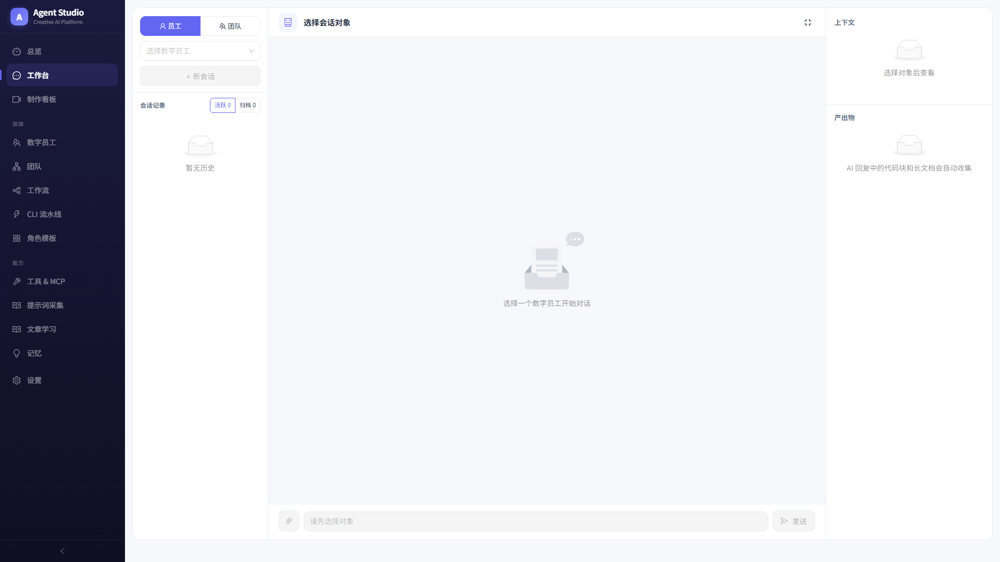

# 🎬 Agent Platform

[English](README.en.md) | 简体中文

**AI-powered anime/manga production pipeline — from script to final cut.**

An open-source multi-agent platform for AI-driven short-form anime (漫剧) production. Features a 10-stage production kanban (script → character/scene design → storyboard → image prompts → video prompts → generation → final cut), DIFY-style visual workflow engine, and multi-agent collaboration with delegated task execution.

**AI 驱动的漫剧全流程制作平台，从剧本到成片。**

开源多智能体协作平台，专为 AI 竖屏漫剧制作设计。内置 10 阶段制作看板（剧本 → 角色·场景设定 → 视觉设计 → 分镜 → 图片提示词 → 视频提示词 → 生图 → 生视频 → 成片），类 DIFY 可视化工作流引擎，多个 AI 数字员工按 DAG 流程图自动接力完成复杂任务。



---

## Screenshots / 截图

### Production Kanban / 制作看板


### Workflow Canvas / 工作流画布编辑器


### AI Workbench / AI 对话工作台


---

## 核心功能

### 数字员工管理
- **员工注册表** — 每个员工有独立身份（`employeeKey`）、角色提示词（`roleProfile`）、绑定的工具和技能
- **角色模板库** — 内置 12 种预设角色（数据分析师、文案写手、代码审查员、SEO 分析师等），一键创建员工
- **独立知识库** — 每个员工可上传专属文档（`.txt` / `.md`），对话时自动检索相关片段注入上下文
- **长期记忆** — 对话结束后自动提取关键信息存入员工长期记忆，下次对话可回忆历史

### 团队协作
- **团队结构** — 团队有队长（`leaderEmployeeKey`）、成员角色分阶段排列（统筹 → 创作 → 设计 → 生成）
- **智能委派** — 团队内员工可通过 `delegate_to_employee` 工具将子任务委派给队友，支持深度限制和环路检测
- **审批闸门** — 高风险操作需人工审批（`##PENDING_APPROVAL##`），审批通过后才继续执行

### 可视化工作流引擎（类 DIFY）
- **DAG 画布编辑器** — 基于 ReactFlow 的拖拽式流程图编辑，连线即定义执行顺序
- **11 种节点类型**：

  | 节点 | 作用 |
  |------|------|
  | **开始** | 工作流入口，声明输入字段 |
  | **智能体** | 调用一个数字员工执行任务（多 SubAgent 的核心） |
  | **知识检索** | 检索指定员工知识库片段，注入下游节点 |
  | **条件分支** | if/else 规则路由（支持 12 种比较运算符） |
  | **文本拼装** | 用 `{{node.field}}` 变量模板组合文本，零 token 消耗 |
  | **工具调用** | 调用已注册的工具 / MCP 服务 |
  | **迭代** | 对 JSON 数组逐项调用员工（可限流并行），汇总结果 |
  | **HTTP 请求** | 调用外部 API，响应注入变量池 |
  | **代码** | Python 表达式数据变换（AST 白名单，绝不 exec/import），零 token |
  | **子工作流** | 嵌套执行另一条工作流（深度上限 3） |
  | **结束** | 汇总输出并返回最终结果 |

- **变量系统** — `{{start.topic}}`、`{{writer.output}}` 等变量在节点间传递数据
- **分支剪枝** — 条件节点只激活命中的出边，死分支整支跳过
- **并行执行** — 无依赖的节点自动并行（`asyncio.gather`）
- **运行面板** — 逐节点查看执行状态、耗时、Token 用量、工具调用轨迹
- **运行历史** — 每次运行自动持久化，支持回溯查看

### 自动化学习
- **提示词采集** — 配置目标网站，定时抓取高质量提示词存入指定员工的知识库
- **文章学习** — 给定文章 URL 列表，LLM 自动总结要点并写入员工知识库 + 长期记忆
- **定时调度** — 内置 DailyScheduler（每 30 秒巡检，边沿触发）：趋势同步 02:00、记忆蒸馏 03:00、自我进化 04:00，
  采集/学习源按各自的 `scheduleTime`。所有任务都是**当天幂等**的，且「今天跑过了」以落盘产出/运行日志为准，
  **进程重启不会重跑**；失败当天不自动重试（避免每 30 秒重试一整天），可用各自的手动端点立刻重跑

### AI 趋势雷达（`/trends`）
- **五源追踪** — GitHub 榜单 + Hacker News + arXiv + Google News + Reddit；后四者按需拉取，带 2 小时 TTL 缓存
- **今日要点（默认首屏）** — 每天从上百条候选里，只挑「你没看过 且 与你在做的事相关」的最多 6 条，
  **先给一句话结论**（这是什么、能拿来干什么），再给「为什么和你相关」。
  点「已读」即**永久消失**，之后任何一天的简报都不会再出现它——不重复看同样的东西。
  兴趣画像可在「调整关注点」里编辑（`data/trends/profile.json`），改完下次生成即生效。
  候选先按源配额取样（GitHub 32 + 其余各 12），避免 GitHub 的星数量纲碾压其他源
- **AI 分析报告** — LLM 汇总全部领域数据，产出热门赛道 / 崛起新星 / 技术转变 / 语言洞察 / 开发者建议。
  与「今日要点」分工：这里是**全景**（每天重算，内容会重复），那里是**只给你看的增量结论**
- **自动同步** — 每天 `TRENDS_SYNC_TIME`（默认 02:00）刷新全部 8 个 GitHub query，拉到新数据后**强制重生成** AI 分析报告。
  开关 `TRENDS_AUTO_SYNC`（默认开）。同步是**当天幂等**的：调度器与 Windows 计划任务 `SkillTrackerDaily`、
  CLI `python -m skill_tracker.daily_run` 三个入口并存也不会重复消耗 GitHub 配额（`-f` 可强制重拉）
- **处处可点详情** — 榜单 / 报告里的仓库名点击打开详情抽屉（Stars、Forks、涨星、Topics、快照 star 走势）；
  报告里的仓库会跨全部 query 查找归属领域；HN / arXiv / 新闻 / Reddit 每行也可点开详情
- **配额** — GitHub 搜索匿名限流 10 次/分钟，一次全量同步需 16 次请求。建议配置 `GITHUB_TOKEN`（无需任何 scope）提升到 30 次/分钟
- **产出保留** — 同步后自动清理旧的 `skills_*.json`（每个 query 留最近 5 份）。
  `output/snapshots/` 永不清理：star 历史走势只存在于快照里，GitHub 不提供历史 star 数，删了不可再生

### 导演 Agent（默认入口 `/studio`）
- **一条生产主线** — 新建创意后只显示剧本、分镜、画面提示、图片、视频提示、视频、成片七步进度，并根据真实素材缺口给出唯一下一步；原制作看板保留为高级下钻
- **OpenRouter 原生媒体生成** — 实时读取 OpenRouter 专用图片/视频模型目录；图片直接落地项目素材目录，视频按异步任务提交、轮询并自动回填到对应 G 镜头
- **明确费用确认** — 批量生图/生视频前展示模型、镜头数量与 OpenRouter 价格信息，必须再次确认才会提交，不会因打开页面或刷新而消耗额度
- **镜头审片与成片** — 同页预览每个 G 的剧本、首帧、视频与审核状态；全部镜头就绪后调用本机 FFmpeg 统一画幅并按顺序合成 MP4 预览
- **桌面与手机同流程** — 手机端使用单列镜头审片，七步阶段条在自身区域横向滑动；页面主体不产生横向溢出

### 制作看板（Production Pipeline）
- **10 阶段流水线** — 创意/原著 → 剧本 → 角色·场景 → 视觉设计 → 分镜 → 图片提示词 → 视频提示词 → 生图 → 生视频 → 成片；GC（概念宣传片）同样先锁定场景、角色时期与视觉母版，再进入逐镜故事板和媒体生成
- **真实交付就绪度** — 项目/剧集进度不再按“已生成文案卡”计 100%，而是按规格齐全 40% + 出图 30% + 视频 20% + 成片交付 10% 计算；首页直接提示断链、待出图、待视频或待交付的下一步动作
- **结构化建项向导** — 新建项目分三步填写目标、计划集数、单集时长、画幅、视觉风格、预算、原始素材与默认 AI 员工；支持 GC（概念宣传片）项目类型，选择后自动设 1 集/30s 并隐藏集数时长；旧项目字段缺失时保持兼容
- **层级下钻视图** — `剧 → 全局资产/剧集网格 → 单集 G 生成单元 → 按阶段资源`逐级展开（`/production/:pid`），与平铺流水线视图（`/production/:pid/pipeline`）随时切换
- **按集组织** — Episode Tab 切换（全局资产 / EP01 / EP02...），全局角色场景跨集共享
- **文字设定与视觉设计分离** — 先定义角色场景的文字设定（身份层/装备层/可变层），再做视觉三视图和概念图
- **AI 逐阶段生成** — 每个阶段可一键 AI 生成；按集生成（上下文=本集卡片+全局资产），默认追加落卡，替换模式只清同阶段**同集**旧卡片；G1/G2 标题会自动归入对应生成单元
- **素材图片服务** — 内置资源文件 API，直接在卡片中预览已有的角色三视图、场景图、道具图；支持 `?w=64|128|256|512` 服务端 WebP 缩略图（磁盘缓存、按源文件 mtime 失效、fail-open 回退原图）
- **全链路对照**（`/production/matrix`）— 跨季矩阵：行=G 生成单元，列=剧本/分镜/首帧/末帧锁/视频提示词/图/视频；断链红叉、只看断链/没图筛选、出图进度、点行下钻单集；孤儿卡（挂在不存在单元上的卡）告警 + 归档区（`data/production/<pid>/archive/` 一卡一文件，不删除、可恢复）
- **提示词批量导出** — 单集详情页「导出提示词」把整集头部 + 各 G 单元首帧/末帧/视频提示词按生成顺序拼成 markdown，一键下载并复制，对接小云雀/即梦等外部生成端
- **镜头级返工台** — 单集详情页可直接编辑某个 G 的剧本、分镜、正向/负向提示词，并只重新生成该 G 的指定阶段；图片提示词卡可立即调用已启用的 images 模型生图，新图作为版本追加且可切换当前版本，不覆盖旧图
- **视觉故事板与视频参考包** — 分镜按 ≤6 秒子镜头“一镜一卡”，历史 G 大分镜可一键拆卡并逐镜生成故事板图；视频提示词卡自动汇总同 G 故事板、首尾帧和全局人物三视图/定妆图，供支持多图参考的视频模型选用
- **卡片系统** — 每张卡片支持内容、提示词、图片、视频、元数据，支持 Markdown 渲染

### 自由画布（数据的可视化生成台）
- **定位** — 看板是表视图，画布是图视图，同一份生产数据。节点=数据（剧本/设定/分镜/提示词）或图片（参考图/出图回传），连线=派生血缘。出图仍走小云雀/即梦半自动路径（提示词一键复制），平台不重造生成器
- **AI 派生（核心动作）** — 指着任意数据节点选数字员工 + 目标阶段 + 指令，员工生成 1~N 个下游数据节点并自动连血缘线；阶段指令模板与看板逐阶段生成共用（`STAGE_INSTRUCTIONS`），员工知识库中的固定描述词（Art Bible）在派生中自动生效
- **看板双向** — 「从看板导入」把某项目/某集/某阶段的卡片按阶段分列铺进画布（单次≤60 张）；数据/图片节点一键「回写看板」成对应阶段卡片
- **参考图与可选生图** — 本地图片上传成图片节点（点击放大预览）；配好 OpenAI 兼容 images 模型后图片节点可做 API 变体（可选，非主路径）
- **无限画布基建** — ReactFlow 平移缩放连线、1.2s 防抖自动保存落盘 `data/canvas/`、生成图片转存本地防远端 URL 过期

### 对话工作台
- **实时对话** — 选择员工直接开始 AI 对话
- **会话管理** — 自动保存会话历史，支持加载历史会话
- **工具轨迹** — 实时展示 AI 调用了哪些工具、传了什么参数、返回了什么结果

### 桌面总览与任务中心
- **行动导向总览** — 首屏展示最近项目、真实交付就绪度、生产阻塞、后台失败任务和明确的“下一步”，系统资源统计不再占据主视觉
- **用户任务列表** — `/tasks` 自动列出当前账号最近任务并轮询进行中状态，支持取消、失败重试、结果查看；Job ID 查询仅作为兼容入口
- **桌面信息架构** — 默认只展示导演 Agent、制作项目、素材画布、模型与设置；员工/工作流/记忆库/链路诊断等工具收进“高级功能”；大型页面按路由懒加载

## 文档导航（想快速搞懂某个模块从这进）

| 文档 | 回答什么问题 |
|------|------------|
| [docs/RUNBOOK.md](docs/RUNBOOK.md) | **怎么把项目跑起来**:零配置最短路径、端口坑、配置双轨制、常见报错解法、data/ 目录地图、根目录文件辨析 |
| [scripts/README.md](scripts/README.md) | 全部 31 个脚本的清单:用途/跑法/一次性还是可复用/是否破坏性 |
| [docs/ROADMAP.md](docs/ROADMAP.md) | **未来一年目标与方向**:KPI、季度计划、优化项、欠账、机会与不做清单 |
| [docs/ARCHITECTURE.md](docs/ARCHITECTURE.md) | 系统怎么运转的（分层 + 5 条核心数据流）、**想改 X 去哪个文件**速查表 |
| [docs/MODULE_INDEX.md](docs/MODULE_INDEX.md) | 全部 160+ 模块的一句话职责索引（自动生成：`python -m scripts.gen_module_index`） |
| [docs/CHANGELOG.md](docs/CHANGELOG.md) | 每次改动的动机 / 变更点 / 影响面 |
| 代码内 docstring | 每个类/函数的意图与约束（全中文，AST 扫描保证零缺失） |

## 技术架构

```
┌───────────────────────────────────────────────┐
│                 React 前端                      │
│  React 18 + Ant Design 5 + ReactFlow + Vite   │
│  端口: 5173 (开发) / 静态部署 (生产)            │
└───────────────┬───────────────────────────────┘
                │ /api 代理
┌───────────────▼───────────────────────────────┐
│              FastAPI 后端                       │
│  Python 3.12 + Pydantic v2 + OpenAI SDK       │
│  端口: 8000 (开发) / 5311 (默认)               │
├───────────────────────────────────────────────┤
│  app/api/         REST API 路由层              │
│  app/runtime/     Agent 循环 + 提示词编译       │
│  app/services/    工作流引擎 + 知识库 + 调度器   │
│  app/tools/       工具注册表 + 内置工具          │
│  app/models/      Pydantic 数据模型             │
│  data/            JSON 文件存储（运行时生成）     │
└───────────────────────────────────────────────┘
```

### 后端技术栈
- **Python 3.12** + **FastAPI** — 异步 Web 框架
- **Pydantic v2** — 数据校验与序列化（camelCase 别名兼容前端）
- **OpenAI SDK** — LLM 调用（兼容 OpenAI 格式的任意网关）
- **httpx** — 异步 HTTP 客户端
- **存储双模式** — 默认 JSON 文件（零依赖，原子写入）；`USE_DB_STORES=true` 时运行态（运行记录/会话/长期记忆/向量）切 **PostgreSQL**（SQLAlchemy 2.0 + Alembic 迁移），并发安全由事务保证
- **pgvector + DashScope embedding** — 知识库语义检索（不配 API key 自动退化为关键词检索）
- **Redis + arq** — 异步任务队列（agent 后台运行）；slowapi 接口限流 + 员工月度 token 配额
- **Prometheus + Grafana** — `/metrics` 指标（HTTP / 运行次数 / Token / 成本）+ 自动置备面板
- **structlog** — 结构化日志 + request_id 全链路追踪 + 统一异常信封
- **asyncio** — 工作流并行执行 + 定时调度

### 前端技术栈
- **React 18** + **TypeScript**
- **Ant Design 5** — UI 组件库
- **ReactFlow 11** — 工作流画布
- **React Router 6** — SPA 路由
- **Vite 6** — 构建工具 + 开发服务器 + HMR

### 生产部署形态（docker-compose）

| 服务 | 端口 | 说明 |
|------|------|------|
| app | 8000 | 用户端 API + 前端 SPA |
| admin | 8001 | 管理端（用户/角色/AI 供应商治理，独立鉴权） |
| worker | — | arq 异步任务消费者（可独立扩容） |
| postgres (pgvector) | 5432 | 关系数据 + 向量检索 |
| redis | 6379 | 任务队列 / 限流 |
| prometheus | 9090 | 指标采集 |
| grafana | 3000 | 监控面板（自动置备「Agent 运行概览」） |

### GitHub Actions 自动部署

`master` 的 push 或手动触发 Actions 后，会先并行执行后端测试与前端类型检查/构建；全部通过才进入
`production` 环境，通过受限 SSH 账号调用 `scripts/deploy-server.sh`，最后请求
`https://aikirito.cloud/healthcheck` 验证外部访问。生产部署串行执行，并校验服务器实际部署的 commit
必须等于本次已测试的 `GITHUB_SHA`。

GitHub `production` 环境需要配置：

- Variables：`DEPLOY_HOST`、`DEPLOY_USER`、`DEPLOY_SSH_KNOWN_HOSTS`
- Secret：`DEPLOY_SSH_KEY`

服务器 `.env`、`data/production/`、`data/ai-providers/` 与 `data/.secrets/` 不进入 Actions，继续由
生产服务器持久化和部署脚本保护。仓库为私有仓库时，服务器另用一把 GitHub **只读 Deploy Key** 拉取
代码，不保存个人 PAT。具体运维方式见 [docs/RUNBOOK.md](docs/RUNBOOK.md#10-github-actions-自动部署)。

## 快速开始

### 方式一：Docker Compose 一键全套

```bash
cp .env.example .env      # 按需修改密码/密钥
docker compose up -d --build
```

前端 http://localhost:8000 · 管理端 http://localhost:8001（默认 `admin/admin123`，生产请改）· Grafana http://localhost:3000

### 方式二：本地开发（以下 1-5 步）

> **零配置就能跑**：不建 `.env`、不建 `appsettings.Development.json`、不起 PG/Redis，后端照样启动，
> 默认账号 **admin / admin123**。LLM 供应商可以事后在管理端 UI 配置；API Key 会在服务器加密后
> 落盘 `data/ai-providers/`，接口只返回掩码。
> 端口坑、可选服务矩阵、常见报错解法见 **[docs/RUNBOOK.md](docs/RUNBOOK.md)**。

### 环境要求
- Python 3.12+
- Node.js 18+
- 一个兼容 OpenAI API 格式的 LLM 服务（需要配 endpoint 和 API Key；可事后在管理端 UI 配）

### 1. 克隆仓库

```bash
git clone https://github.com/tongren025/agent-platform.git
cd agent-platform
```

### 2. 后端配置

推荐先启动服务，登录管理端 `/admin/providers` 添加供应商。浏览器提交真实 Key 后，服务器使用 Fernet
加密写入 `data/ai-providers/*.json`；刷新、编辑和查询接口都只会返回掩码。标准 Compose 使用
`app_data` 持久卷，生产 Compose 使用服务器 `./data` bind mount；部署脚本会在更新代码前后专门保护
`ai-providers` 与 `.secrets`，所以远程服务器重启、重建容器或重新部署都不会丢失。

生产环境建议在服务器 `.env` 固定一把主密钥（不提交 Git）：

```bash
python -c "from cryptography.fernet import Fernet; print(Fernet.generate_key().decode())"
# 把输出保存为服务器 .env 的 AI_PROVIDER_ENCRYPTION_KEY=...
```

留空也能使用：服务器第一次保存供应商 Key 时会在持久卷自动生成主密钥。备份或迁移服务器时必须同时
保留主密钥，否则已有密文无法恢复。

也可以创建 `appsettings.Development.json`（此文件已被 `.gitignore` 排除）使用环境变量引用：

```json
{
  "aiModels": [
    {
      "name": "default",
      "endpoint": "https://your-openai-compatible-endpoint/",
      "apiKey": "sk-your-api-key-here",
      "enabled": "true",
      "models": [
        {
          "modelName": "gpt-4o",
          "modelId": "gpt-4o",
          "timeoutMinutes": 20
        }
      ]
    }
  ]
}
```

> 支持任何兼容 OpenAI Chat Completions API 的服务（OpenAI、Azure OpenAI、各类国产大模型网关等）。
> `apiKey` 也可以写成环境变量占位符（如 `"${OPENROUTER_API_KEY}"`），真实密钥放 `.env` 或系统环境变量。

OpenRouter 示例：

```json
{
  "aiModels": [
    {
      "name": "openrouter",
      "endpoint": "https://openrouter.ai/api/v1",
      "apiKey": "${OPENROUTER_API_KEY}",
      "enabled": "true",
      "models": [
        {
          "modelName": "OpenRouter Auto",
          "modelId": "openrouter/auto",
          "timeoutMinutes": 20
        }
      ]
    }
  ]
}
```

使用时在员工默认模型里选 `openrouter/auto`，或把 OpenRouter 控制台里的模型 ID 加到 `models` 后再选择。也可以显式写 `openrouter:openrouter/auto` 锁定 OpenRouter 供应商。

### 3. 启动后端

```bash
# 创建虚拟环境
python -m venv .venv

# 激活（Windows）
.venv\Scripts\activate
# 激活（Linux/Mac）
source .venv/bin/activate

# 安装依赖
pip install -r requirements.txt

# 启动（开发环境用 8000 端口，与前端代理一致）
uvicorn app.main:app --host 127.0.0.1 --port 8000 --reload
```

> ⚠️ 不要用 `python -m app.main` 启动——它读业务配置 `Port` 默认起在 **5311**，前端代理会对不上。
> 管理端（可选）：`uvicorn admin.main:app --port 8001 --reload`；
> 异步任务 worker（可选，需 Redis）：`python -m app.tasks.worker`——不起它任务中心的任务会一直排队。

### 4. 启动前端

```bash
cd web
npm install
npm run dev
```

### 5. 打开浏览器

访问 http://localhost:5173 即可使用。

## 项目结构

```
agent-platform/
├── app/                          # Python 后端
│   ├── api/                      # REST API 路由
│   │   ├── agent.py              #   智能体对话 API
│   │   ├── registry.py           #   员工/团队/工具/技能 CRUD
│   │   ├── workflow.py           #   工作流 CRUD + 运行
│   │   ├── production.py         #   制作看板 API（项目/卡片 CRUD + AI 生成 + 资源服务）
│   │   ├── scrape.py             #   提示词采集 + 文章学习 API
│   │   ├── memory_api.py         #   记忆管理 API
│   │   └── strategy_proxy.py     #   策略代理 API
│   ├── models/                   # Pydantic 数据模型
│   │   ├── registry.py           #   员工/团队/工具/技能/模板定义
│   │   ├── workflow.py           #   工作流/节点/边/运行记录
│   │   ├── production.py         #   制作看板模型（10阶段+GC 8阶段流水线/卡片/项目/STAGE_INSTRUCTIONS）
│   │   ├── conversation.py       #   对话请求/响应
│   │   ├── knowledge.py          #   知识库文档
│   │   ├── learn.py              #   文章学习源
│   │   ├── scrape.py             #   提示词采集源
│   │   └── memory_types.py       #   长期记忆类型
│   ├── runtime/                  # Agent 运行时
│   │   ├── loop.py               #   Agent 主循环（LLM 调用 + 工具分派）
│   │   ├── runner.py             #   运行编排（快照加载 → 循环 → 结果）
│   │   ├── prompt.py             #   系统提示词编译
│   │   ├── snapshot.py           #   员工运行时快照加载
│   │   ├── scope.py              #   作用域构建（工具/技能/MCP 绑定）
│   │   ├── template.py           #   {{变量}} 模板解析引擎
│   │   └── infra_tools.py        #   平台基础设施工具注册
│   ├── services/                 # 业务服务
│   │   ├── workflow_executor.py  #   工作流 DAG 执行引擎（Kahn 遍历）
│   │   ├── workflow_nodes.py     #   11 种节点执行器（插件注册表）
│   │   ├── workflow_store.py     #   工作流运行记录存储
│   │   ├── seed_workflows.py     #   种子工作流（漫剧创作流水线）
│   │   ├── invocation.py         #   员工调用（审批、委派、循环）
│   │   ├── registry.py           #   JSON 文件注册表（通用 CRUD）
│   │   ├── knowledge.py          #   知识库管理
│   │   ├── memory.py             #   会话记忆管理
│   │   ├── memory_extractor.py   #   长期记忆自动提取
│   │   ├── long_term_memory.py   #   长期记忆存储
│   │   ├── ai.py                 #   AI 模型服务（轮询可用模型）
│   │   ├── scheduler.py          #   DailyScheduler 定时调度器
│   │   ├── scraper.py            #   网页抓取 + LLM 总结
│   │   ├── scrape_runner.py      #   提示词采集执行
│   │   ├── scrape_store.py       #   采集源存储
│   │   ├── learn_runner.py       #   文章学习执行
│   │   └── learn_store.py        #   学习源存储
│   ├── tools/                    # 工具系统
│   │   ├── base.py               #   工具注册表 + ToolContext
│   │   ├── builtin.py            #   内置工具（Shell、知识库查询）
│   │   ├── delegate.py           #   委派工具（跨员工任务分发）
│   │   ├── deep.py               #   深度 Agent（子代理模式）
│   │   └── strategy/             #   策略工具（业务定制）
│   ├── config.py                 # 配置加载（appsettings 合并）
│   ├── dependencies.py           # 单例依赖注入
│   └── main.py                   # FastAPI 入口 + 启动迁移
├── web/                          # React 前端
│   ├── src/
│   │   ├── pages/                # 页面
│   │   │   ├── Dashboard.tsx     #   仪表盘
│   │   │   ├── Employees.tsx     #   员工管理
│   │   │   ├── Teams.tsx         #   团队管理
│   │   │   ├── Workflows.tsx     #   工作流列表
│   │   │   ├── WorkflowEditor.tsx#   工作流画布编辑器
│   │   │   ├── Workbench.tsx     #   对话工作台
│   │   │   ├── Production.tsx    #   制作看板（平铺流水线 + 卡片详情）
│   │   │   ├── ProductionHub.tsx #   制作层级总览（剧→全局资产→剧集网格）
│   │   │   ├── EpisodeDetail.tsx #   单集详情（G 生成单元卡片 + 按阶段资源抽屉）
│   │   │   ├── Tools.tsx         #   工具管理
│   │   │   ├── Templates.tsx     #   角色模板库
│   │   │   ├── Memory.tsx        #   记忆管理
│   │   │   ├── Settings.tsx      #   系统设置
│   │   │   ├── AutoLearn.tsx     #   提示词采集
│   │   │   └── ArticleLearn.tsx  #   文章学习
│   │   ├── components/
│   │   │   ├── Layout.tsx        #   全局布局（自绘侧边栏）
│   │   │   ├── TraceList.tsx     #   工具调用轨迹组件
│   │   │   └── workflow/         #   工作流专用组件
│   │   │       ├── WorkflowNodeCard.tsx  # 画布节点卡片
│   │   │       ├── NodeConfigDrawer.tsx  # 节点配置抽屉
│   │   │       ├── RunPanel.tsx          # 运行面板
│   │   │       └── nodeMeta.ts           # 节点类型元数据
│   │   ├── api.ts                # API 调用封装
│   │   ├── types.ts              # TypeScript 类型定义
│   │   ├── theme.ts              # 主题色彩常量
│   │   ├── App.tsx               # 路由配置
│   │   └── main.tsx              # 入口
│   ├── package.json
│   ├── vite.config.ts            # Vite 配置（/api 代理到 8000）
│   └── tsconfig.json
├── appsettings.json              # 基础配置
├── appsettings.Production.json   # 生产环境配置
├── requirements.txt              # Python 依赖
├── pyproject.toml                # Python 项目元数据
└── WORKFLOW_ENGINE.md            # 工作流引擎技术文档
```

> **M0–M6 生产化新增**（未列入上图）：`app/core/`（settings/logging/db/queue/rate_limit/embedding/metrics 基础设施）、`app/tasks/`（arq worker）、`admin/`（管理端服务 :8001）、`app/models/db/`（ORM）、`migrations/`（Alembic）、`tests/`、`deploy/`（Prometheus/Grafana 置备）、`docker-compose.yml` + `Dockerfile`。详见 [docs/CHANGELOG.md](docs/CHANGELOG.md)。
>
> **其它顶层目录**（上图与注脚之外）：`scripts/`（31 个脚本，[清单](scripts/README.md)）、`skill_tracker/`（GitHub 榜单工具，趋势雷达数据源）、`evals/`（LLM 输出回归评测）、`automations/`（Claude 定时自动化的持久记忆）、`wwwroot/`（前端构建产物挂载点）、`resouce/`（本地媒体素材根，目录名拼写即如此，gitignore）、`docs/`（RUNBOOK/ARCHITECTURE/MODULE_INDEX/ROADMAP/CHANGELOG）。逐一解释见 [docs/RUNBOOK.md](docs/RUNBOOK.md) §7。

## API 概览

API 前缀：`/api/v1/agentapp`（唯一例外：pipeline 组用 `/api/v1/pipeline`）。
后端共挂载 18 组 router、约 175 个端点，下表只列高频组——canvas / trends / skills /
memory / evolution / ai-providers / auth 登录等完整端点以 `app/api/` 代码与 `/docs`（Swagger）为准。

### 注册表（`/registry`）
| 方法 | 路径 | 说明 |
|------|------|------|
| GET | `/employees` | 列出所有员工 |
| POST | `/employees` | 创建员工 |
| PUT | `/employees/{key}` | 更新员工 |
| DELETE | `/employees/{key}` | 删除员工 |
| GET | `/teams` | 列出所有团队 |
| POST | `/teams` | 创建团队 |
| GET | `/tools` | 列出所有工具 |
| GET | `/role-templates` | 列出所有角色模板 |
| POST | `/employees/{key}/knowledge` | 上传知识库文档 |
| GET | `/employees/{key}/knowledge` | 列出知识库文档 |

### 智能体（`/agent`）
| 方法 | 路径 | 说明 |
|------|------|------|
| POST | `/run` | 运行智能体对话（携带 `approvalDecision` 字段可恢复审批挂起的运行，无独立 approve 端点） |
| GET | `/sessions` | 列出会话 |
| GET | `/sessions/{id}` | 获取会话详情 |
| GET | `/agent/ai-providers` | 列出可用 AI 供应商与模型 |
| GET | `/agent/runs` | 运行记录列表（Token/成本/耗时） |
| GET | `/agent/quota/{employee_key}` | 员工本月 token 用量与配额 |

### 异步任务（`/tasks`）
| 方法 | 路径 | 说明 |
|------|------|------|
| POST | `/tasks/agent-run` | 员工运行入队（后台执行，不占请求连接） |
| GET | `/tasks` | 当前用户最近任务列表（最多 100 条） |
| GET | `/tasks/{job_id}` | 查询任务状态 / 结果 |
| POST | `/tasks/{job_id}/cancel` | 取消当前用户的排队中/执行中任务 |
| POST | `/tasks/{job_id}/retry` | 使用原参数重新入队任务 |

> 知识检索升级：`GET /registry/employees/{key}/knowledge/search?q=` — 配置 `DASHSCOPE_API_KEY` 且 `USE_DB_STORES=true` 时走向量语义检索，否则退化关键词。
> 管理端另有独立服务（:8001，前缀 `/api/admin`）：登录、用户/角色/权限、AI 供应商治理。

### 工作流（`/workflow`）
| 方法 | 路径 | 说明 |
|------|------|------|
| GET | `/` | 列出所有工作流 |
| POST | `/` | 创建工作流 |
| GET | `/{key}` | 获取工作流详情 |
| PUT | `/{key}` | 更新工作流 |
| DELETE | `/{key}` | 删除工作流 |
| POST | `/{key}/run` | 运行工作流 |
| GET | `/{key}/runs` | 运行历史 |
| GET | `/{key}/runs/{run_id}` | 单次运行详情 |
| GET | `/node-types` | 可用节点类型列表 |

### 制作看板（`/production`）
| 方法 | 路径 | 说明 |
|------|------|------|
| GET | `/projects` | 列出所有制作项目 |
| POST | `/projects` | 创建制作项目（支持集数/时长/画幅/风格/预算等结构化参数） |
| GET | `/projects/{pid}` | 获取项目详情（含所有卡片） |
| GET | `/projects/{pid}/stats` | 卡片状态统计 + G 单元真实交付就绪度 |
| POST | `/projects/{pid}/cards` | 添加卡片 |
| PUT | `/cards/{id}` | 更新卡片 |
| DELETE | `/cards/{id}` | 删除卡片 |
| POST | `/projects/{pid}/generate` | AI 生成指定阶段卡片（`episode` 按集、`mode` 追加/替换；生成结果过静态质量门禁，不合格降级 `review`） |
| GET | `/stages` | 获取 10 阶段定义 |
| GET | `/matrix` | 跨项目「季 → 集 → G 单元」全链路对照矩阵 |
| GET | `/orphans` | 孤儿卡列表（挂在不存在 G 单元上的卡片） |
| POST | `/projects/{pid}/archive` | 归档卡片（一卡一文件，可恢复不删除；`GET` 同路径列归档，`/{card_id}/restore` 恢复） |
| GET | `/projects/{pid}/search` | 关键词 + 阶段/状态/集数/负责人组合过滤卡片 |
| GET | `/resource/{path}` | 静态资源文件服务（图片/视频，`?w=` 缩略图） |

> production 组共 27 个端点，成员管理 / 批量移动/删除/改状态 / 卡片上传等其余端点见 `app/api/production.py`。

### 自动学习（`/scrape`）
| 方法 | 路径 | 说明 |
|------|------|------|
| GET | `/sources` | 采集源列表 |
| POST | `/sources` | 创建采集源 |
| POST | `/sources/{key}/run` | 立即执行采集 |
| GET | `/learn-sources` | 学习源列表 |
| POST | `/learn-sources` | 创建学习源 |
| POST | `/learn-sources/{key}/run` | 立即执行学习 |

## 安全设计

- **API 强制鉴权** — 用户端所有 `/api/*` 端点须携带 `Authorization: Bearer <token>`(登录获取);读操作任何登录用户可用,写操作按角色权限(admin/editor/viewer)前缀映射拦截;禁用账号立即失效。开关 `USER_API_AUTH`(默认开)。管理端(:8001)独立鉴权
- **工具节点授权** — 工作流中的工具节点必须指定授权员工（`employeeKey`），且工具必须在该员工的 `toolRefs` 绑定列表内才能执行
- **黑名单机制** — Shell 执行（`execute`）和跨员工委派（`delegate_to_employee`）在工作流节点中硬禁止
- **审批闸门** — 工具返回 `##PENDING_APPROVAL##` 时，工作流节点按失败处理，不会静默跳过人工审批
- **参数注入防护** — 工具参数模板先解析为结构化 JSON 再序列化，插入值被 JSON 转义，无法篡改工具参数
- **委派安全** — 深度限制（默认 3 层）+ 环路检测（`__delegation_stack`）+ 可全局关闭
- **Shell 白名单** — Shell 执行默认关闭，开启后仅允许白名单内的命令
- **条件节点** — 使用安全枚举比较器，绝不使用 `eval`
- **变量解析** — 正则匹配 `{{node.field}}`，缺失变量返回空串（fail-soft），绝不执行动态代码

## 内置示例

### 漫剧创作工作流（演示，默认不注入）

设置 `SEED_DEMO_WORKFLOWS=true` 后，系统启动时种入一条 13 节点、16 条边的**漫剧创作工作流**（默认关闭：演示运行结果不进制作看板），包含 9 个数字员工：

```
导演（统筹）
  → 编剧（创作）
    → 角色设计师 ┐
    → 场景设计师 ├ 并行（设计）
    → 分镜设计师 ┘
      → 提示词工程师（设计）
        → 角色生成师 ┐
        → 场景生成师 ├ 并行（生成）
        → 关键帧生成师┘
          → 成片合成
```

在「工作流」页面可以看到并直接运行这条流水线。

### 制作看板 — 九陆纪元五季制作卡池

附带完整的竖屏漫剧生产数据：**五季 120 集共 4062 张卡**（`data/production/jiulu-s1..s5`，已入版本库），演示 10 阶段流水线：

```
创意/原著 → 剧本 → 角色·场景 → 视觉设计 → 分镜 → 图片提示词 → 视频提示词 → 生图 → 生视频 → 成片
```

- 每集按 G 生成单元组织（导演 Brief → 镜头拆分表 → G 单元剧本 → 分镜 → 首帧/末帧锁图片提示词 → ≤6 秒子段视频提示词 → 质检）
- 分镜卡已全量升级 v2 详细版（起止姿态/前中后景/画面位置/连续性锚点，可直接绘制）
- 卡池由多轮脚本生成与修复演进而来，生成链路见 [scripts/README.md](scripts/README.md)（注意其中的危险区说明）

## 已知限制（v1）

- ~~LLM 调用同步~~ — **已解决**：agent 主链路已迁 AsyncOpenAI（含超时、指数退避重试、同供应商换模型、跨供应商 fallback），并行节点真并发；仅画布生图（`canvas.py`）与网页抓取总结（`scraper.py`）两条旁路仍为同步裸调
- **无 SSE 实时推送** — 运行状态通过轮询获取，暂无 Server-Sent Events 实时更新
- ~~文件存储无锁~~ — **已解决**：`USE_DB_STORES=true` 时运行态切 PostgreSQL（事务保并发安全）；JSON 仍为默认（单人零依赖）
- ~~节点类型待扩展~~ — **已扩展**：迭代（循环）、HTTP 请求、代码执行、子工作流均已上线（共 11 种节点）；仅变量聚合节点仍在规划

## 代码备份

`scripts/git_auto_backup.ps1` 会把工作树完整快照（含未提交改动）提交到 `auto-backup`
分支并推送 GitHub，不影响 master 和进行中的工作。配合每日计划任务使用（注册命令见
[docs/CHANGELOG.md](docs/CHANGELOG.md) 对应条目）；也可随时手动跑一次。
误删文件时用 `git checkout auto-backup -- <路径>` 找回。

## 生产化里程碑（已完工）

| 里程碑 | 内容 | 状态 |
|--------|------|------|
| M0 | Docker Compose / `.env` 密钥 / structlog / request-id / 统一异常 / CI | ✅ |
| M1 | 运行态存储 PostgreSQL 可切换（Alembic + JSON 导入脚本） | ✅ |
| M2 | LLM 成本核算（`modelPrices` 价目 → 运行记录落真实成本） | ✅ |
| M3 | 向量语义检索（pgvector + DashScope，fail-open 退化关键词） | ✅ |
| M4 | 异步任务队列（arq + Redis + worker 容器） | ✅ |
| M5 | 接口限流（slowapi）+ 员工月度 token 配额 | ✅ |
| M6 | Prometheus 业务指标 + Grafana 自动置备面板 | ✅ |

逐项动机 / 变更点 / 影响面见 [docs/CHANGELOG.md](docs/CHANGELOG.md)。**不做多租户**。

## 许可证

[AGPL-3.0](LICENSE)。个人使用、自部署、二次开发完全自由;若基于本项目对外提供网络服务(含 SaaS),需按同协议开源你的修改。商业闭源授权请通过 Issue 联系。
