# 《九陆纪元》GC 制作故事板 v2

## 目标与定义

本批资产采用的是**制片故事板（production storyboard）**，不是成片概念海报，也不是把一段动作压进同一张图的五格动作轨迹板。

- 一个画面只表达一个决定性剧情节拍。
- 先写景别和机位，再写角色、动作、场景与视觉处理。
- 人物与龙的外形由正式母版锁定；场景图只用于空间布局，不继承旧图的噪点和绘画质感。
- 默认每个 G 单元一张竖屏画面；确有切镜的 G5、G6 分成 A/B 两张。
- 故事板以缩略图可读性、轮廓和空间关系为主，不追求最终成片级微细节。

## 检索依据

- [Adobe Firefly：创建商业故事板](https://helpx.adobe.com/ph_fil/firefly/how-to/create-commercial-storyboard-firefly-boards.html)：先建立起始画面和风格锚点，再逐格生成并保持面板一致性。
- [Adobe Firefly：视频提示词写法](https://helpx.adobe.com/uk/firefly/web/work-with-audio-and-video/work-with-video/writing-effective-text-prompts-for-video-generation.html)：提示词按“景别 + 角色 + 动作 + 场景 + 美学”组织。
- [Google Cloud：Veo 视频生成提示词指南](https://docs.cloud.google.com/gemini-enterprise-agent-platform/models/video/video-gen-prompt-guide?authuser=00)：明确主体、动作、环境、镜头与风格，避免互相冲突的描述。
- [Storyboarder.ai：3D Camera Angle](https://help.storyboarder.ai/en/articles/14691476-the-new-3d-camera-angle-feature-in-storyboarder-ai)：用景别、视角和机位高度表达故事板镜头意图。
- [OCR：Guide to Storyboards（PDF）](https://www.ocr.org.uk/Images/579489-guide-to-storyboards.pdf)：故事板重点是逐镜头传达画面构图、动作与连续性。

## 统一生成提示词

以下是本次使用的主提示词结构。方括号内容按镜头替换；`Image 1/2/3` 对应风格锚点、正式角色/生物母版和场景布局参考。

```text
Use case: illustration-story.
Asset type: one professional film production storyboard frame for a vertical 9:16 animated drama.

Input images:
- Image 1: use only as the clean storyboard rendering and value-structure anchor.
- Image 2: preserve the exact character/creature identity, costume, proportions and silhouette.
- Image 3: use only for location layout and major landmarks; do not inherit its noise or painterly texture.

Primary request:
[只描述一个清楚可见的决定性剧情节拍。]

Composition and camera:
[景别]，[机位高度与俯仰角]，[主体在画面中的位置]，[前景/中景/背景关系]。
Use one frozen camera state. Make the silhouette, eyeline and dramatic focal point readable at thumbnail size.

Style and medium:
clean graphite-and-ink production storyboard, light warm-gray paper, smooth three-value grayscale,
controlled line weight, large simple value shapes, sparse selective color accents only on the story focal point,
crisp edges on the subject, quiet background, clean negative space, high clarity, low visual noise.

Hard constraints:
one frame only; one decisive pose; production storyboard, not final key art;
no text, subtitles, numbers, arrows, motion diagrams, UI, panel grid, border labels, logo or watermark.

Avoid:
photorealism, finished concept art, cinematic poster, painterly texture, film grain, paper speckles,
salt-and-pepper noise, fog covering faces, excessive hatching, excessive micro-detail,
multiple poses of the same subject, split screen, collage, five-panel sequence.
```

## 逐镜头提示词集

| 镜头 | 景别 / 机位 | 单一决定性节拍 | 色彩焦点 |
|---|---|---|---|
| G1 九陆之瞳 | 眼部极特写，正面 | 巨眼刚刚睁开，虹膜中映出九陆与世界树 | 金色虹膜 |
| G2 命运拒绝 | 中远景，略俯拍 | 前期苍霖跪在祭坛中心，法则光环碎裂熄灭 | 熄灭前的微弱金光 |
| G3 双心跳 | 中景，平视 | 胸口碎片与龙蛋同时脉动，两圈波纹在空间中相交 | 胸口与龙蛋暖光 |
| G4 第一次被需要 | 近景，低机位 | 幼龙鼻尖轻触苍霖受伤的手指 | 指尖与幼龙眼睛暖光 |
| G5A 三个月后 | 龙眼极特写 | 成年龙的眼睑开启，瞳孔锁定前方 | 熔岩橙瞳 |
| G5B 三个月后 | 大远景，低机位 | 成年龙立于熔岩荒原，后期苍霖已骑在龙背 | 熔岩裂隙 |
| G6A 删除令 | 极远景，仰拍 | 冷色舰队列阵覆盖天空，删除光束开始聚焦 | 冷蓝光束 |
| G6B 删除令 | 眼部极特写，平视 | 苍霖的眼睛映出锁定红点，目光不退 | 单一红色锁定点 |
| G7 又来 | 近景，略低机位 | 苍霖微偏头，嘴角出现很轻的冷笑 | 远处红点 |
| G8 熔浆龙焰 | 大全景，贴近熔岩的低机位 | 成年龙压低身体，从熔岩上方向冷蓝光束爬升 | 橙色熔岩与蓝色光束 |
| G9 不配被删 | 大远景，侧逆光 | 龙焰横扫舰队，最近一艘舰船开始熔解 | 龙焰橙白核心 |
| G10 世界在死 | 极远景，正面 | 世界树八条脉络熄灭，只剩一条连接苍霖胸口 | 最后一条金色脉络 |
| G11 我自己选 | 背面全景，平视 | 苍霖面对虚空门迈出第一步，龙守在侧后方 | 门内微金光 |

## v2 故事板总页

|  |  |  |
|---|---|---|
| **G1 九陆之瞳**<br>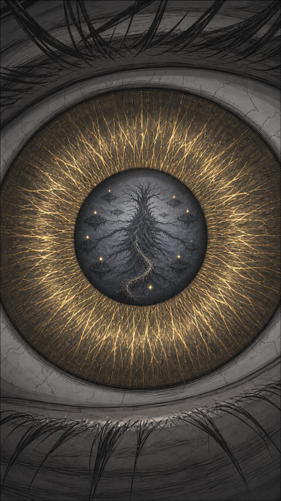 | **G2 命运拒绝**<br>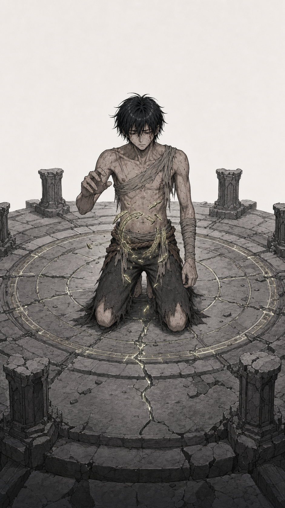 | **G3 双心跳**<br>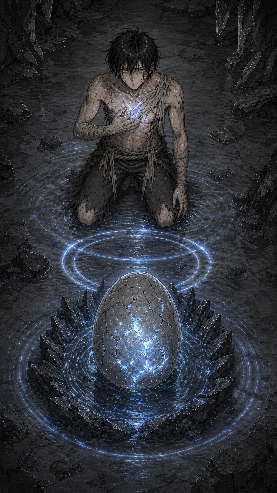 |
| **G4 第一次被需要**<br>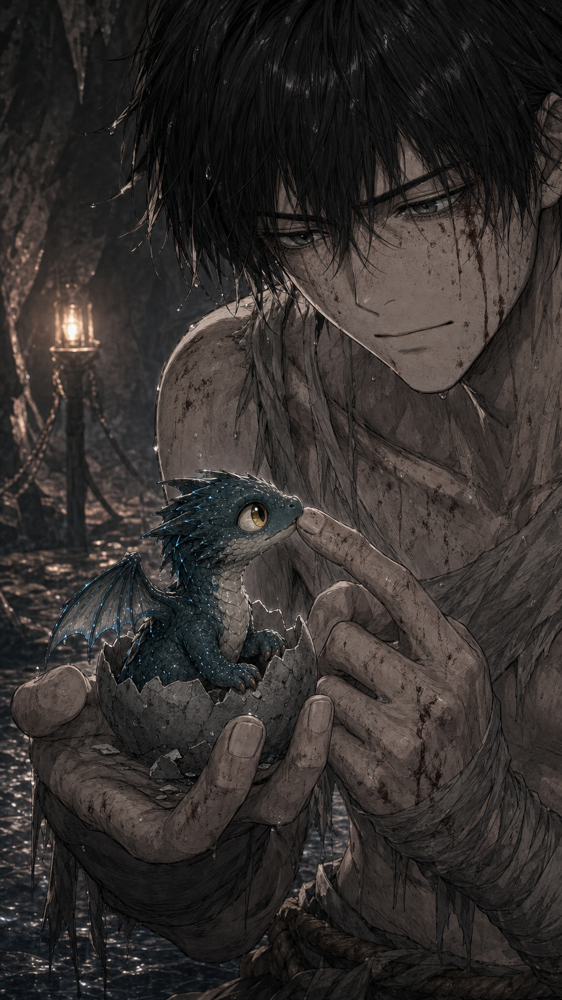 | **G5A 龙眼特写**<br>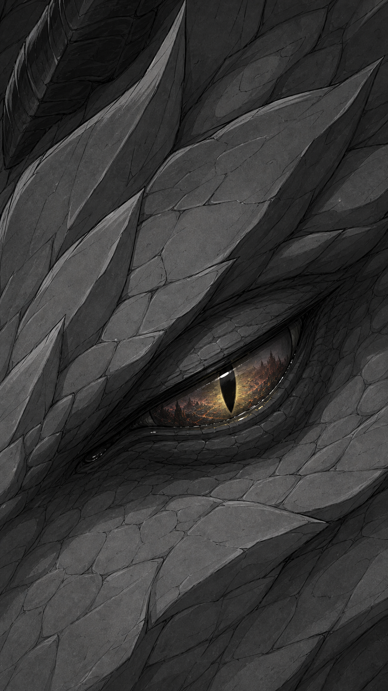 | **G5B 揭示全景**<br>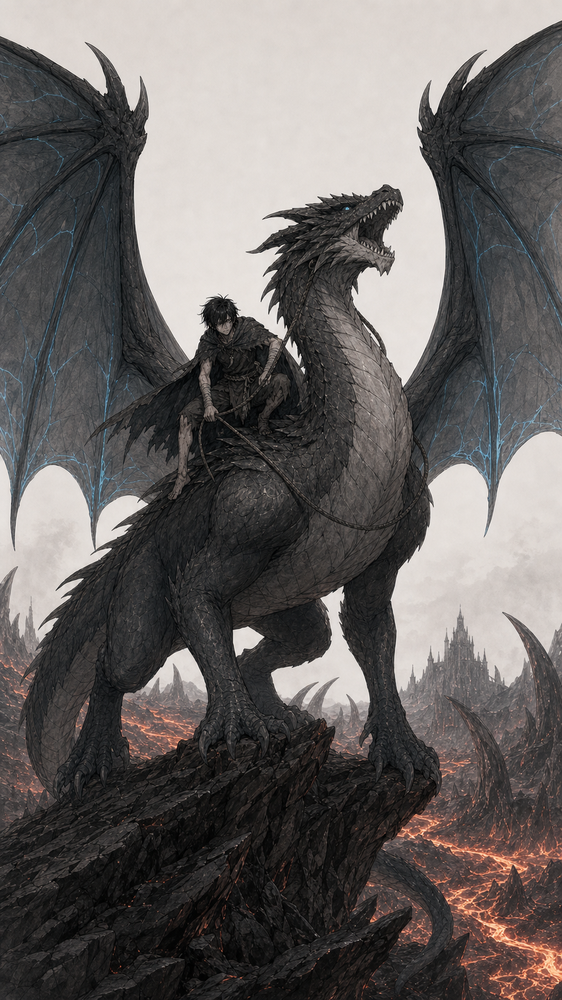 |
| **G6A 舰队大远景**<br>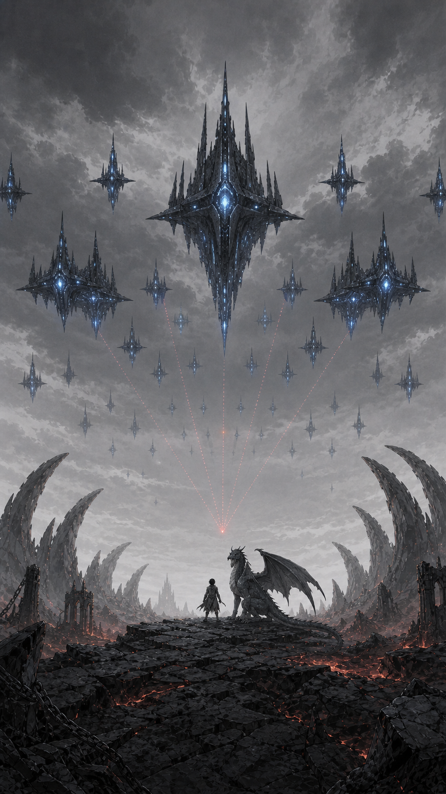 | **G6B 眼部锁定**<br>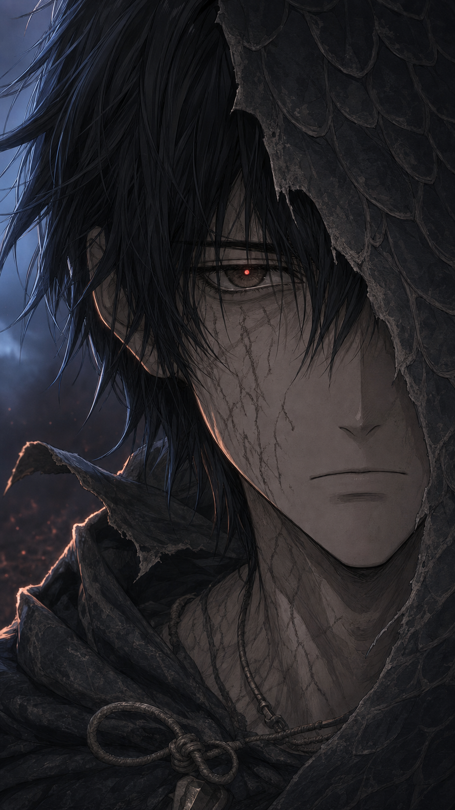 | **G7 又来**<br>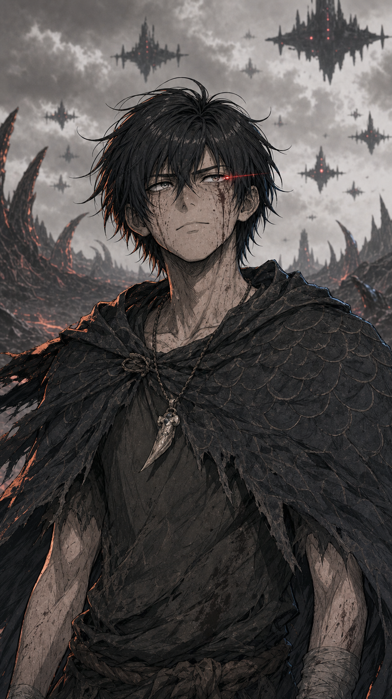 |
| **G8 熔浆龙焰**<br>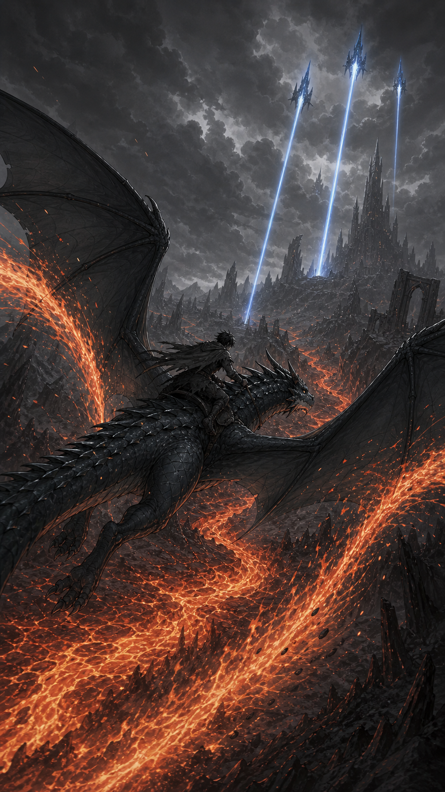 | **G9 不配被删**<br>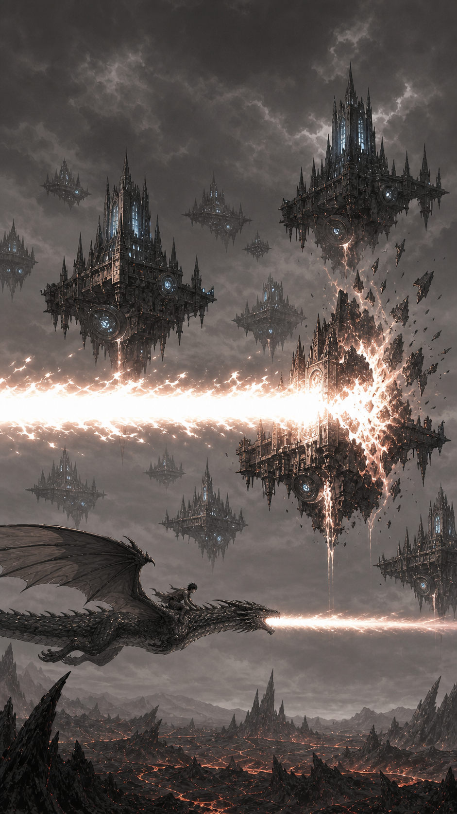 | **G10 世界在死**<br>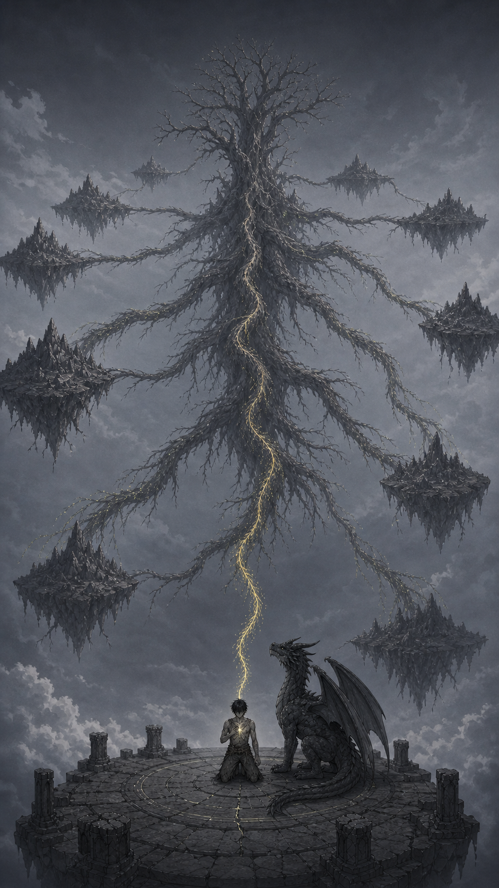 |
| **G11 我自己选**<br>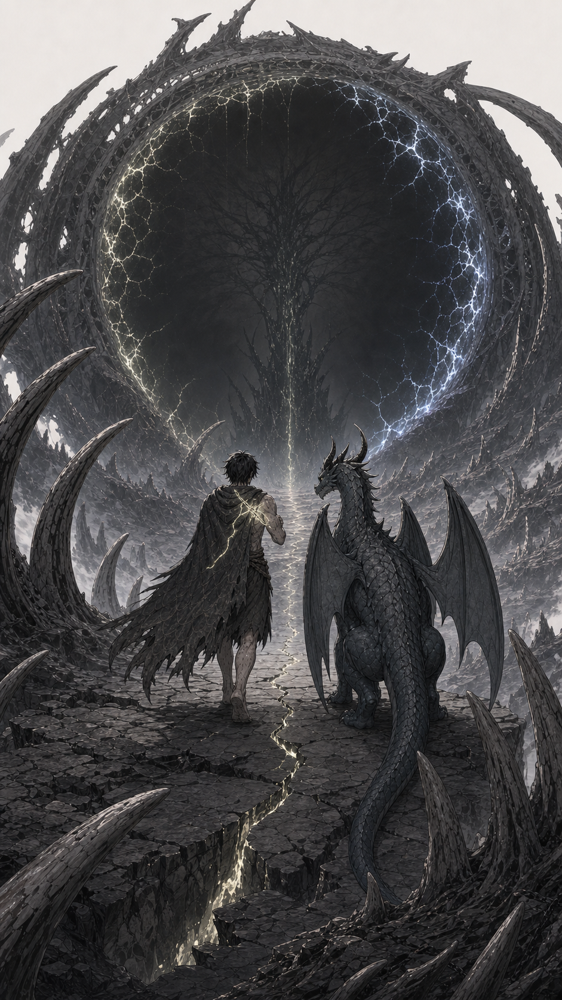 |  |  |

## 项目接入

- 生成模式：`generate`，以正式角色/生物母版和场景布局图作为参考图，不重绘旧版五格故事板。
- 输出规格：13 张 PNG，统一为 9:16（941 × 1672）。
- 生产卡资产类型：`production_storyboard_frame_sequence`。
- G1–G4、G7–G11 各 1 张；G5、G6 各 2 张；旧版 `动作轨迹_v1` 文件保留但不再作为 GC 生产卡首选资产。
