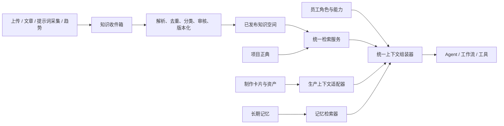

# 知识体系架构：从“功能集合”收口为一人工作室知识中枢

> 状态：目标架构与迁移约束。实施顺序见
> [`plans/KNOWLEDGE_SYSTEM_BLUEPRINT.md`](../plans/KNOWLEDGE_SYSTEM_BLUEPRINT.md)。

## 一、结论与目标

当前系统已经具备员工知识文档、关键词/向量检索、三层长期记忆、文章学习、提示词采集、
制作卡片和 Art Bible 等组件，但这些组件缺少统一的知识边界与生命周期。

本次收口的目标不是再造一个知识库产品，而是建立三条硬规则：

1. **同一事实只有一个权威来源**，其它模块只保存引用，不复制正文。
2. **所有知识进入 Agent 前经过同一个检索与上下文组装入口**。
3. **外部资料和模型自产内容默认不可信**，必须经过准入、去重与版本治理。

北极星仍然是 `docs/ROADMAP.md` 定义的“单集成片周期”。知识体系只有在减少找资料、
设定冲突和返工时才有价值。

## 二、当前问题

### 2.1 事实重复

角色 DNA、场景设定、风格锚和 Seedance 规则同时存在于员工 `roleProfile`、员工知识文档、
长期记忆和制作卡片。修改其中一份不会同步其它副本，旧版本可能与新版本同时注入。

### 2.2 入库链路分叉

- 手工上传：文件落盘后后台切片与向量化。
- 文章学习：直接写知识文档和语义记忆。
- 提示词采集：直接替换知识文档。
- 脚本种入：直接操作 `KnowledgeStore` 或索引文件。

这些入口没有共享“待处理 → 已索引 → 已发布”的状态机，也没有统一的来源、版本和内容哈希。

### 2.3 检索入口不一致

对话预检索和搜索 API 采用“向量优先、关键词兜底”；工作流知识节点与
`query_knowledge_base` 工具只走关键词。相同问题从不同入口进入时可能得到不同资料。

### 2.4 上下文没有统一预算

一次生产调用可能同时注入角色提示词、知识片段、三类长期记忆和全部前置制作卡片。
当前没有跨来源去重、权威排序、版本过滤和总 Token 上限。

### 2.5 记忆准入过宽

会话达到四条消息后，每轮都会重新分析整段历史；文章学习还会把同一知识同时保存为文档和
语义记忆。经验记忆不做相似合并，容易把模型自己的推断长期化。

## 三、统一词汇与唯一事实源

| 信息类型 | 唯一事实源 | 作用域 | 谁能修改 | 注入策略 |
|---|---|---|---|---|
| 员工身份、职责、输出契约 | 员工 `roleProfile` 与绑定配置 | employee | 人工 | 精简后固定注入 |
| 行业方法、岗位 SOP | 专业方法知识空间 | global / role | 人工审核 | 按需检索 |
| 项目正典、Art Bible、角色和场景 | 项目正典空间 | project | 人工审批 | 最高权威、按项目检索 |
| 集、G 单元、镜头和资产状态 | 制作卡片 | project / episode / unit | 流程生成 + 人工审批 | 通过生产上下文适配器读取 |
| 用户偏好与明确纠正 | 语义记忆 | user / employee | 用户确认或受控提取 | 查询相关时少量注入 |
| 已验证的成功经验 | 经验/行为记忆 | employee | 人工采纳 | 低配额、按需注入 |
| 文章、提示词、趋势原文 | 知识收件箱 | source | 自动采集 | 审核前绝不注入 |
| 技能、工具、MCP、角色模板 | Agent 能力配置 | platform | 人工 | 不归入内容知识库 |

禁止事项：

- 禁止把项目正典复制进多个员工 `roleProfile`。
- 禁止把制作卡片全文复制进长期记忆。
- 禁止外部采集内容未经审核直接成为项目正典。
- 禁止把“能力关系图”当成内容知识图谱。

## 四、目标架构



实现上继续使用现有 FastAPI、JSON/SQLAlchemy 和 PostgreSQL + pgvector，不引入独立向量数据库、
微服务或新的记忆运行时。

## 五、知识对象契约

知识文档最终至少需要以下元数据；JSON 模式与 PG 模式保持同一契约：

| 字段 | 说明 |
|---|---|
| `docId` | 稳定文档 ID |
| `spaceType` | `global / role / project / employee / inbox` |
| `spaceKey` | 岗位、项目或员工的稳定 key |
| `kind` | `canon / sop / reference / example / external` |
| `status` | `draft / reviewing / published / deprecated / failed` |
| `authority` | `canonical / reviewed / unverified` |
| `version` | 可比较版本；正典变更必须递增 |
| `sourceType/sourceUri` | upload、article、scrape、generated 及原始位置 |
| `contentHash` | 去重和幂等入库依据 |
| `indexStatus` | `pending / indexed / degraded / failed` |
| `chunkCount` | 实际成功索引的片段数 |
| `validFrom/validTo` | 角色时期等时效范围，可空 |
| `createdAt/updatedAt` | 创建与更新时间 |

向量切片必须保存原始 `docId`、片段序号、标题路径和真实相似度，不能用
`docId_chunk_0` 冒充用户可见文档 ID，也不能用排名伪造相关性分数。

JSON 与 PG 必须通过同一组参数化存储契约测试：`contentHash` 在知识空间内唯一；`revision`
单调递增并支持 CAS；时间统一为 UTC ISO 8601；查询使用稳定的次级排序。JSON 写入使用跨进程文件锁、
临时文件和原子替换，PG 使用唯一约束和事务，避免“文档已写入但状态或索引任务丢失”。

## 六、统一知识生命周期

```text
采集或上传
  → contentHash 去重
  → 解析与正文清洗
  → inbox/draft
  → 人工审核或可信规则自动审核
  → published
  → 持久化索引任务与 generation
  → 切片 + 关键词索引 + embedding
  → 原子激活新 generation
  → 可检索
  → 新版本发布后旧版本 deprecated，异步清理旧 generation
```

约束：

- 入库成功不等于可检索；前端必须展示 `indexStatus`。
- 向量化失败允许降级关键词，但必须可见，不能只写日志。
- 同一来源重复运行必须幂等；自动文档替换时同步清除旧向量。
- 删除文档需要同时删除文件、元数据和所有索引。
- 自动采集只写收件箱；项目正典只能人工发布。
- 索引前先持久化任务；JSON 使用本地任务箱，PG/队列模式使用 outbox，启动时重放未完成任务。
- 检索只读取已激活 generation；构建、激活、清理分三步，任一步崩溃都不能暴露半套索引。

## 七、统一检索与上下文组装

### 7.1 检索入口

所有调用方统一依赖一个 `KnowledgeQueryService`：

- 对话预检索；
- `/knowledge/search` API；
- 工作流知识节点；
- `query_knowledge_base` 工具；
- 生产生成的项目正典查询。

检索请求至少包含：`query`、允许的知识空间、项目/员工作用域、`topK`、总字符或 Token 预算。

### 7.2 权威优先级

上下文冲突时按以下顺序覆盖：

1. 当前任务中的用户明确指令；
2. 当前项目已发布正典；
3. 当前集/G 单元的已审批生产事实；
4. 已审核岗位 SOP；
5. 用户明确偏好与纠正；
6. 已采纳经验；
7. 普通参考资料。

未审核外部资料不得参与冲突裁决。

### 7.3 上下文预算

首轮建议值：

- 员工固定提示词：不超过约 2,000 Token；
- 项目正典与生产事实：不超过约 4,000 Token；
- 专业方法：不超过约 2,000 Token；
- 长期记忆：不超过约 800 Token；
- 检索片段总数：默认 8，单来源默认不超过 3；
- 按 `contentHash` 和高相似文本去重，并保留来源引用。

具体数值以后由评测调整，不散落硬编码在多个调用方。

## 八、记忆准入策略

### 可以进入长期记忆

- 用户明确表达的长期偏好；
- 用户对系统行为的明确纠正；
- 有清晰成功证据、可跨任务复用的方法；
- 人工采纳的进化建议。

### 不得进入长期记忆

- 助手自己生成但用户未确认的项目事实；
- 制作卡片全文或项目正典副本；
- 一次性任务参数；
- 外部文章摘录；
- 无成功证据的“经验”。

自动提取必须按不可变 `messageId/sequence` 增量执行，以稳定 watermark 和消息范围生成幂等键；PG 在同一事务中
完成记忆 upsert 与游标 CAS，JSON 使用跨进程文件锁。若“记忆已写入、游标未推进”，重试必须命中同一幂等键，
不得生成第二份记忆。
行为和经验记忆默认进入待审状态，至少在评测门禁建立前不自动改写员工提示词。

## 九、面向一人团队的信息架构

默认导航只保留完成作品需要的入口：

1. **导演 Agent**：今天应该做什么、唯一下一步、付费动作确认。
2. **制作项目**：项目 → 集 → G 单元 → 素材/审片。
3. **知识中心**：正典、专业方法、知识收件箱、Agent 记忆。
4. **模型与设置**：供应商、成本与系统开关。

原“文章学习”“提示词采集”“记忆库”归入知识中心；原“知识图谱”更名为“能力关系图”。
高级页面保留直达路由用于调试，不承担日常生产主路径。

默认治理采用低维护模式：只有项目正典、高权威冲突和行为规则改写需要逐条人工确认；普通重复项自动合并，
知识收件箱批量处理。待审核积压设置上限，每周维护预算不超过 30 分钟，并把“每集人工操作次数不增加”作为门禁。

## 十、治理指标与验收

知识体系不能只看“文档数量”，至少观察：

- 正典冲突数与过期引用数；
- 入库成功率、索引成功率、待审核积压；
- 检索评测 top3 命中率；
- 单次上下文 Token、重复片段比例；
- 记忆新增/合并/驳回数量；
- 因设定不一致造成的返工卡片率；
- 从项目概要到完整草稿所需的人工操作次数。

第一阶段验收：所有知识检索入口行为一致；会话记忆只增量提取；前端不再展示虚假的格式、
字段和能力名称；一人用户可以从一个知识中心找到所有知识相关操作。冻结同一份确定性基线后，
正典类用例 top3 命中率为 100%，整体 top3 不低于 90%，上下文重复字符占比不超过 5%，固定任务 Token
和每集人工操作次数均不得高于改造前基线。

## 十一、明确暂缓

- 暂缓 Letta 接线；现有记忆准入收口前不增加第二套运行时。
- 暂缓真正的实体关系知识图谱；先保证唯一事实源和检索质量。
- 暂缓独立向量数据库、微服务拆分和多租户知识隔离。
- PDF/docx、reranker 和复杂混合检索放在统一入库、评测和状态可见之后。
