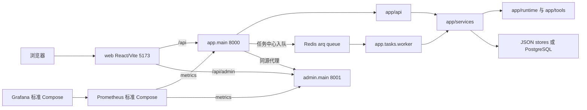

# 架构总览

核验日期：2026-09-15。本文描述仓库主应用，事实来源是当前源码、README 和 Compose 文件。

## 系统边界

主平台由 React/TypeScript/Vite 前端、用户端 FastAPI、管理端 FastAPI 和可选的 arq worker 组成。两个 API 是独立进程，共享 app 的业务服务与部分数据；项目不做多租户。

| 层 | 实现 |
|---|---|
| 后端 | Python 3.12+、FastAPI、Pydantic、Uvicorn；依赖以 requirements.txt 为准 |
| 主前端 | React 18、TypeScript 5、Vite 6、antd 5、React Router 6；见 web/package.json |
| 数据 | SQLAlchemy、PostgreSQL 16 + pgvector、Alembic；JSON store 默认启用 |
| 任务 | Redis 7 + arq；只有任务中心的 agent job 走独立 worker |
| 监控 | app/admin 的 /metrics；标准 Compose 含 Prometheus/Grafana |
| 子工程 | modules/yuxi-runtime/web 是 Vue 子工程；third_party/nomi 是画布集成源码 |

## 入口与目录地图

- app/main.py：用户端生命周期、中间件、路由注册、uploads/assets 与 SPA fallback。
- admin/main.py：管理 API；admin/api/ 提供认证、系统、用户、角色、供应商路由，不托管页面。
- web/src/main.tsx、web/src/App.tsx：React 根、antd 中文环境、BrowserRouter 和页面路由。
- web/src/api.ts、web/src/adminApi.ts：用户端和管理端请求封装。
- app/api/：HTTP 层，按 agent、workflow、pipeline、production、director、canvas、tasks 等拆分。
- app/services/：业务用例与 store；services/invocation.py 是员工调用统一入口。
- app/runtime/：scope/snapshot、提示词、模型与工具循环、MCP、CLI。
- app/tools/：内置、媒体、委派、深度任务与策略工具。
- app/models/、app/models/db/：领域 DTO 与 SQLAlchemy 表。
- app/dependencies.py：全局 registry/store/service 组装，决定部分运行态的 JSON/PG 实现。
- app/core/：基础设施配置、数据库会话、认证、中间件、日志、限流、队列、指标。
- migrations/、tests/、evals/：数据库迁移、pytest 测试、真实模型评估。
- data/、wwwroot/：运行数据/素材、主前端构建输出。

## 配置分工

| 文件 | 负责内容 |
|---|---|
| app/config.py | 以 appsettings.json 为基础，APP_ENV 为 production/prod 时合并 appsettings.Production.json，其余环境合并 appsettings.Development.json；读取业务目录、超时、模型、价目、配额和 Port |
| app/core/settings.py | 从环境变量和 .env 读取 DB/Redis、USE_DB_STORES、鉴权、CORS、日志、加密密钥、ADMIN_API_URL、趋势调度 |
| admin/config.py | 从环境变量读取管理账号、ADMIN_SECRET、token TTL、ADMIN_PORT |

Agent.AdminApiBaseUrl 默认 5040，是策略模块使用的外部 admin API；本站管理代理使用 ADMIN_API_URL，默认 8001。USE_DB_STORES 只切换会话、运行记录、长期记忆及向量相关 store；注册表和工作流定义仍由各自实现管理。

## 请求与任务入口

普通请求顺序为 CORS、请求上下文/访问日志、可选用户鉴权、router、service/store。healthcheck 只表示进程存活，不验证 DB、Redis 或模型。

| 入口 | 实际执行 |
|---|---|
| /api/v1/agentapp/agent/run | API 内等待 run_invocation |
| /api/v1/agentapp/agent/run-stream | API 内创建 task，以 SSE 推送增量 |
| /api/v1/agentapp/workflow/{key}/run | API 内 await run_workflow，受业务整体超时约束 |
| /api/v1/pipeline/run | API 内 await run_pipeline，等待 CLI 流水线 |
| /api/v1/agentapp/tasks/agent-run | 入 Redis 后返回 job ID，worker 执行 run_agent_task |

生产同源 /api/admin/* 由 app/api/admin_proxy.py 转发到 ADMIN_API_URL。生产 Compose 使用 nginx 对外暴露 80/443/8001，没有 Prometheus/Grafana；标准 Compose 直接暴露 8000/8001/5432/6379/9090/3000。

功能改动必须更新 docs/CHANGELOG.md；影响启动、端口或环境变量时同步 README。
