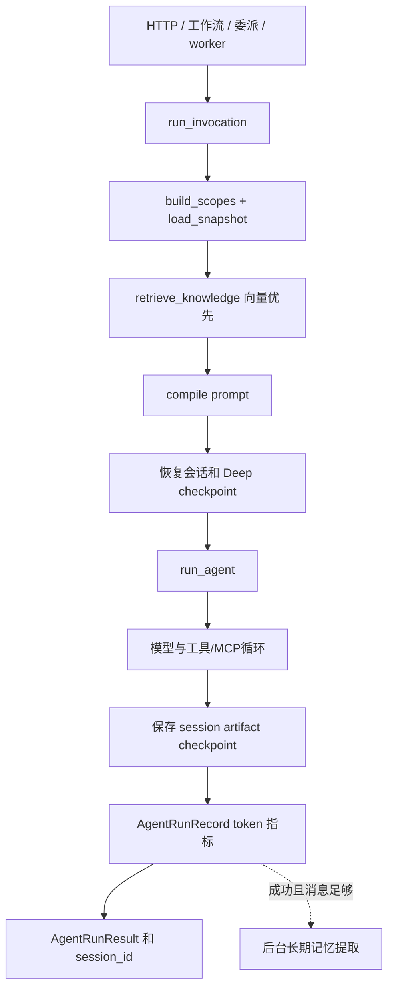
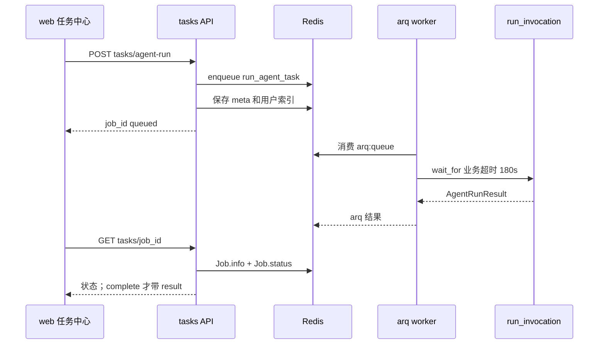

# 运行时与执行路径

核验日期：2026-09-15。启动和排障命令见 OPERATIONS.md。

## 用户端生命周期

app.main 的 lifespan 依次执行员工字段兜底迁移、团队成员回填、可选演示工作流种子、内置漫剧 registry 迁移，然后启动 DailyScheduler；关闭阶段停止调度器。这些不是 Alembic schema migration。USE_DB_STORES=true 时依赖装配会调用 init_db/create_all 兜底，版本升级仍需显式运行 Alembic。

DailyScheduler 在每个 API 进程内巡检：趋势默认 02:00（TRENDS_SYNC_TIME），蒸馏 03:00、进化 04:00 是代码常量，并用 asyncio.create_task 派发。多 worker 部署时每个进程都会启动它，排查定时任务重复要先检查进程数。

## 员工调用链

services/invocation.py 的 run_invocation 被普通对话、SSE、工作流节点、委派和 arq 任务复用。

scope/snapshot 负责可见员工、技能、工具、MCP 和模型策略；prompt 负责编译系统提示词；runner/loop 负责模型协议、重试和工具循环。历史上下文最多取最近 24 条、约 32000 字符，不会删除 store 中的完整消息。运行记录或指标保存失败不阻断主响应。

## HTTP、SSE、工作流和队列边界

- agent/run 是 API 内同步等待。
- agent/run-stream 在 API 内创建执行 task，通过 SSE 推送增量。
- workflow/{key}/run 在 API 内 wait_for(run_workflow)。
- pipeline/run 在 API 内 await run_pipeline。
- tasks/agent-run 才进入 Redis，由 worker 执行。

因此“长任务都进入 Redis”不成立。API 内执行的流程会受当前进程重启影响；是否可恢复要看对应 store/checkpoint 实现。

## arq 任务中心

WorkerSettings 当前只注册 run_agent_task，并发 10、worker 单 job 超时 600 秒、默认队列 arq:queue。run_agent_task 另受 app.config 的 agent.run_timeout_seconds（默认 180 秒）限制；arq complete 与业务 result.success 是两回事。API 连接 Redis 为 1 秒超时、一次重试、失败后 30 秒熔断；worker 重试 5 次、间隔 1 秒。

任务摘要 agent:task:meta:{job_id} 与用户索引 agent:tasks:user:{username} TTL 为 30 天。Redis 不可用时列表降级为空，入队和具体查询返回错误。取消调用 arq abort，cancelled 只代表 abort 调用结果；重试会创建新 job ID。
